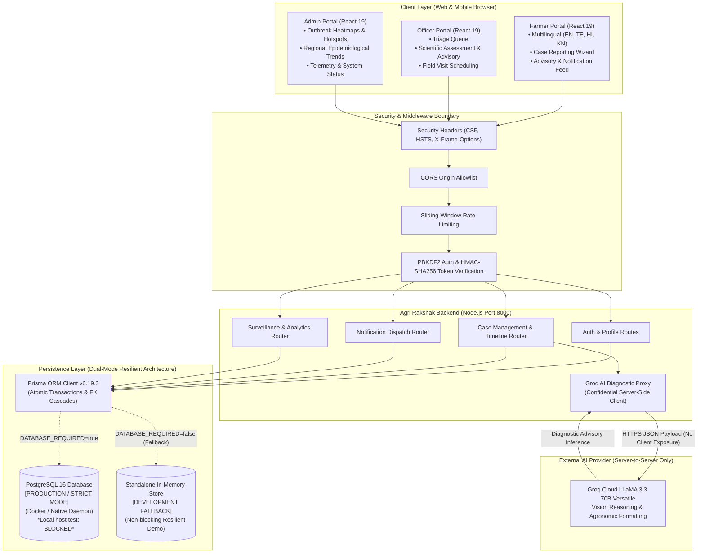
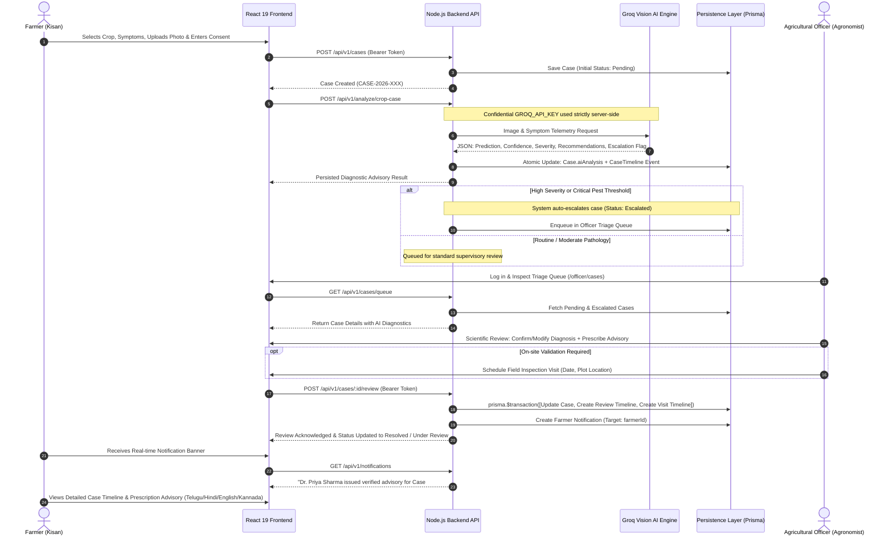
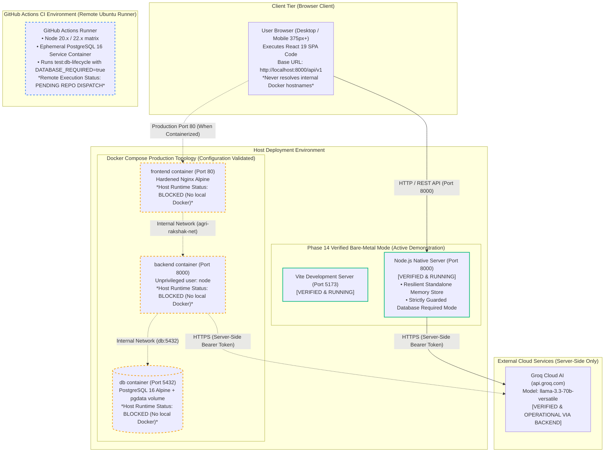

# Agri Rakshak — Architecture & Workflow Diagrams (Phase 15)

**Project:** Agri Rakshak (कृषि रक्षक)  
**SIH Problem Statement:** SIH26131  
**Directory:** `docs/diagrams/`  

This directory contains the editable architectural blueprints, workflow sequences, role-based boundary diagrams, and deployment topologies for Agri Rakshak.

---

## 1. High-Level System Architecture

Editable source: [`system-architecture.mmd`](./system-architecture.mmd)

---

## 2. Farmer-to-AI-to-Officer Workflow

Editable source: [`farmer-officer-workflow.mmd`](./farmer-officer-workflow.mmd)

---

## 3. Role-Based Access Control & API Interaction

Editable source: [`rbac-api-interaction.mmd`](./rbac-api-interaction.mmd)

```mermaid
graph TD
    subgraph Users ["Actors & Client Roles"]
        U_Farmer["Farmer<br/>(kisan@agrirakshak.in)"]
        U_Officer["Agricultural Officer<br/>(officer@agrirakshak.in)"]
        U_Admin["State/District Admin<br/>(admin@agrirakshak.in)"]
    end

    subgraph AuthLayer ["Authentication & Token Verification"]
        LoginEndpoint["POST /api/v1/auth/login<br/>(PBKDF2 Password Verification)"]
        TokenGen["HMAC-SHA256 Token Generator<br/>(Embeds: id, role, phone)"]
        AuthMiddleware["authenticateRequest()<br/>(Validates Signature & Expiration)"]
        RoleMiddleware["requireRole(allowedRoles)<br/>(Strict Role Boundary Enforcement)"]
    end

    subgraph FarmerEndpoints ["Farmer API Scope (Role: 'farmer' or 'admin')"]
        EP_FarmerDash["GET /api/v1/dashboard/farmer"]
        EP_FarmerCases["GET /api/v1/cases (Filtered by farmerId)"]
        EP_CreateCase["POST /api/v1/cases (Ownership Assigned)"]
        EP_AnalyzeCase["POST /api/v1/analyze/crop-case"]
        EP_Notifications["GET /api/v1/notifications (Targeted to farmerId/all)"]
    end

    subgraph OfficerEndpoints ["Officer API Scope (Role: 'officer' or 'admin')"]
        EP_OfficerDash["GET /api/v1/dashboard/officer"]
        EP_OfficerQueue["GET /api/v1/cases/queue (District Scope)"]
        EP_SubmitReview["POST /api/v1/cases/:id/review"]
        EP_UpdateStatus["PATCH /api/v1/cases/:id/status"]
    end

    subgraph AdminEndpoints ["Admin API Scope (Role: 'admin' ONLY)"]
        EP_AdminDash["GET /api/v1/dashboard/admin"]
        EP_Surveillance["GET /api/v1/surveillance/outbreaks"]
        EP_Hotspots["GET /api/v1/surveillance/hotspots"]
        EP_UserMgmt["GET /api/v1/admin/users"]
    end

    U_Farmer --> LoginEndpoint
    U_Officer --> LoginEndpoint
    U_Admin --> LoginEndpoint

    LoginEndpoint --> TokenGen --> AuthMiddleware --> RoleMiddleware

    RoleMiddleware -->|"Allowed: farmer, admin"| EP_FarmerDash
    RoleMiddleware -->|"Allowed: farmer, admin"| EP_FarmerCases
    RoleMiddleware -->|"Allowed: farmer, admin"| EP_CreateCase
    RoleMiddleware -->|"Allowed: farmer, admin"| EP_AnalyzeCase
    RoleMiddleware -->|"Allowed: farmer, admin"| EP_Notifications

    RoleMiddleware -->|"Allowed: officer, admin"| EP_OfficerDash
    RoleMiddleware -->|"Allowed: officer, admin"| EP_OfficerQueue
    RoleMiddleware -->|"Allowed: officer, admin"| EP_SubmitReview
    RoleMiddleware -->|"Allowed: officer, admin"| EP_UpdateStatus

    RoleMiddleware -->|"Allowed: admin ONLY"| EP_AdminDash
    RoleMiddleware -->|"Allowed: admin ONLY"| EP_Surveillance
    RoleMiddleware -->|"Allowed: admin ONLY"| EP_Hotspots
    RoleMiddleware -->|"Allowed: admin ONLY"| EP_UserMgmt

    RoleMiddleware -.->|"Farmer accesses Officer/Admin routes"| Block403["403 Forbidden Response"]
    RoleMiddleware -.->|"Officer accesses Admin surveillance"| Block403
    RoleMiddleware -.->|"Unauthenticated Request"| Block401["401 Unauthorized Response"]
```

---

## 4. Deployment Topology & Verification Status

Editable source: [`deployment-topology.mmd`](./deployment-topology.mmd)

> **Verification Status Transparency:**  
> - **Verified & Operational:** Vite Development Server (`http://localhost:5173`), Native Node.js HTTP Server (`http://localhost:8000`), Groq AI vision engine proxy, Standalone fallback store, strict mode abort logic.  
> - **Configuration Validated / Host Runtime BLOCKED:** Docker Compose orchestration, PostgreSQL 16 live daemon on local Windows host (no Docker/PostgreSQL installed on development host).  
> - **CI Configured / Remote Execution Pending:** GitHub Actions Ubuntu runner with ephemeral PostgreSQL 16 Alpine container (`.github/workflows/ci.yml`).
